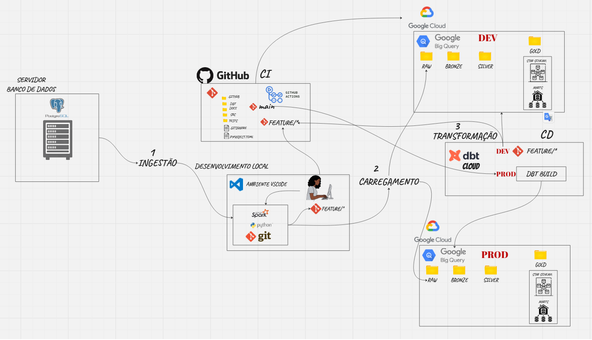
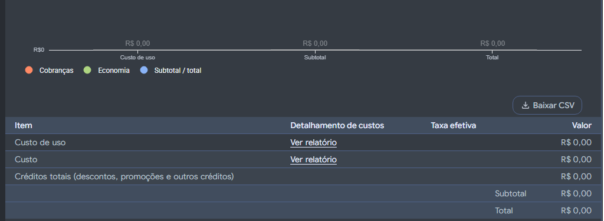

# Enterprise Data Platform

Plataforma de Engenharia de Dados para pequenas e médias empresas, com foco em baixo custo operacional, automação, qualidade dos dados e apoio à tomada de decisões.

## 🏗️ Visão Geral da Arquitetura

O diagrama abaixo ilustra o fluxo completo da plataforma, desde a ingestão dos dados brutos até a entrega analítica no BigQuery, integrando validações automáticas de código e isolamento de ambientes:

### 🔄 Fluxo Operacional da Plataforma

1. **Ingestão e Carregamento (EL):**
   * **Origem:** Banco operacional relacional (PostgreSQL).
   * **Execução:** Pipeline local em Python e PySpark via ambiente VS Code.
   * **Destino:** Carga direta nos datasets brutos (`RAW`) do Google BigQuery nos ambientes de Desenvolvimento (`DEV`) e Produção (`PROD`).

2. **Integração Contínua (CI):**
   * **Gatilho:** Abertura de Pull Requests a partir de branches de funcionalidade (`FEATURE/*`).
   * **Validação:** O GitHub Actions executa linters (`SQLFluff`, `Black`, `Flake8`), checagens estáticas e compilação de código validando contra o ambiente `DEV` no Google Cloud.

3. **Deploy Contínuo e Transformação (CD / dbt Cloud):**
   * **Gatilho:** Merge de código aprovado na branch `main`.
   * **Orquestração:** O dbt Cloud executa o job de produção agendado (`dbt build`), processando e testando as camadas Medallion dentro do BigQuery `PROD`.

---

### O Cenário e o Desafio da Nuvem
Muitas pequenas e médias empresas evitam a migração para a nuvem por receio de faturas imprevisíveis. No entanto, a nuvem não precisa ser onerosa: o verdadeiro diferencial de qualquer iniciativa analítica reside na governança e no consumo consciente de recursos (**FinOps**). Sem planejamento arquitetural, mesmo empresas com altos orçamentos enfrentam desperdícios; já com decisões inteligentes, é viável extrair valor analítico imediato sem comprometer o fluxo de caixa.

O objetivo deste projeto foi projetar e implementar uma plataforma moderna de dados ponta a ponta com **custo inicial zero**, provando que é possível manter governança, desacoplamento e escalabilidade aproveitando estrategicamente serviços open source e camadas gratuitas consolidadas (**Free Tier**).

---

### Decisões de Arquitetura & Otimização de Custos
A plataforma foi desenhada equilibrando processamento local e serviços em nuvem gerenciados:

* **Ingestão Otimizada (EL):** Extração de dados da origem remota e processamento de ingestão executado localmente via Python e PySpark, eliminando o custo recorrente de clusters de computação ligados na nuvem.
* **Armazenamento e Data Warehouse (GCP BigQuery):**
  * **Armazenamento:** Uso da cota do [GCP Free Tier](https://cloud.google.com/bigquery/pricing#storage) com até **10 GB de armazenamento ativo gratuito**, volume suficiente para centralizar dados brutos, históricos e tabelas analíticas.
  * **Processamento sob Demanda:** Consumo dentro da franquia de **1 TiB gratuito mensal de processamento de queries**, ideal para suportar transformações diárias no dbt, testes automatizados e atualização de relatórios no Power BI.
* **Transformação (dbt Cloud):** Adoção do plano gratuito (*Developer* — 1 utilizador), garantindo agendamento de jobs (`dbt build`), governança e documentação sem custos de licença, viabilizando validar o ROI da ferramenta antes de expandir o time.

---

### Impacto e Resultados Técnicos
A entrega consolidou uma plataforma analítica robusta, auditável e pronta para produção com **custo operacional de infraestrutura rigorosamente zerado**. 

  
🔍 <b>Clique aqui para visualizar a comprovação de faturamento ($0.00) no GCP Console</b>

   
  
  

A solução assegura:
* Segregação estrita entre ambientes de desenvolvimento e produção.
* Automação de qualidade e governança via esteira de CI/CD (GitHub Actions + linters).
* Testes nativos de integridade e dados modelados em *Star Schema* prontos para consumo de BI.

O projeto atua como um padrão de referência replicável para operações que demandam modernização analítica com máxima disciplina financeira.