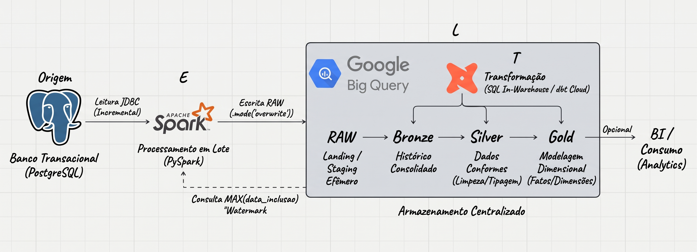

# 📑 Documentação de Arquitetura de Dados: Pipeline e Fluxo de Dados

Esta documentação detalha a arquitetura planejada para a plataforma de dados, baseada no fluxo **PostgreSQL ➔ Apache Spark ➔ Google BigQuery ➔ dbt Cloud**, mapeando o ciclo de vida dos dados desde a origem transacional até a transformação final para consumo analítico.

---

## 🖼️ Diagrama da Arquitetura

O diagrama abaixo ilustra as etapas de Origem, Processamento, Armazenamento e Transformação:

---

## 🔹 1. Origem: Banco Transacional (PostgreSQL)

- **Função:** Base de dados relacional e operacional da empresa, registrando eventos de negócio e movimentações operacionais.
- **Tecnologia:** PostgreSQL.
- **Comportamento dos Dados:**
  - **Inserções Contínuas:** Novos registros são gravados sequencialmente com marcação de `data_inclusao`. Não ocorrem atualizações em registros passados (sem `UPDATE`).
  - **Deleções Operacionais:** A base pode sofrer exclusões físicas (`DELETE`) ocasionais, mas os identificadores (`id`) nunca se repetem, eliminando qualquer risco de colisão de chaves.
- **Impacto no Pipeline:**
  - O script PySpark consulta a data máxima já processada na camada **Bronze** do BigQuery (`MAX(data_inclusao)`) para extrair estritamente os novos registros do PostgreSQL.
  - A camada **RAW** opera como uma área de pouso (*landing/staging*) temporária, sendo sobrescrita a cada execução para carregar apenas o lote novo do dia sem reter dados acumulados.
  - A consolidação e preservação histórica dos registros é gerenciada pelo **dbt** na camada **Bronze**, garantindo que os dados analíticos permaneçam íntegros mesmo após eventuais deleções no banco transacional de origem.
---

## 🔹 2. E — Processamento: Ingestão e Carga (Apache Spark)

- **Função:** Orquestração da extração, processamento em lote (*batch*) e carga dos lotes na área de pouso.
- **Tecnologia:** Apache Spark (via PySpark, conector PostgreSQL JDBC e Google Cloud Spark BigQuery Connector).
- **Ações:**
  - **Conexão:** O Spark conecta-se ao PostgreSQL via JDBC para consultar metadados e extrair fatias de dados.
  - **Carga Inicial (Full):** Para tabelas que ainda não foram inicializadas, realiza a extração completa da tabela de origem e grava o lote inicial na camada `RAW`.
  - **Carga Incremental Eficiente:** Consulta a watermark (`MAX(data_inclusao)`) diretamente na camada **Bronze** do BigQuery e extrai do PostgreSQL estritamente as linhas onde `data_inclusao > ultima_data_bronze`.
  - **Escrita Idempotente na RAW:** Os dados extraídos são gravados na camada `RAW` do BigQuery utilizando `.mode("overwrite")`. A tabela correspondente é substituída apenas com os registros do lote atual, eliminando a necessidade de rotinas externas de limpeza e garantindo reexecuções seguras sem duplicatas.

---

## 🔹 3. L — Armazenamento: Data Warehouse (Google BigQuery)

- **Função:** Armazenamento centralizado, escalável e analítico, desacoplado em camadas lógicas conforme o ciclo de vida dos dados.
- **Tecnologia:** Google BigQuery.
- **Camadas (Datasets):**
  - **RAW (Landing/Staging Efêmero):** Dataset que recebe os dados extraídos pelo PySpark. Armazena temporariamente apenas o lote da execução corrente (`overwrite`), sem reter histórico acumulado.
  - **Bronze (Histórico Consolidado):** Dataset gerenciado pelo dbt via modelos incrementais. Consolida e preserva o histórico permanente e imutável de todos os lotes recebidos da RAW, servindo como fonte única da verdade para a esteira analítica e ponto de corte (*watermark*) para a ingestão.
  - **Silver (Dados Conformes):** Dataset com dados tipados, deduplicados, padronizados e com regras de negócio preliminares aplicadas.
  - **Gold (Modelagem Dimensional):** Tabelas de fatos e dimensões (*Star Schema*) e datamarts preparados para consumo direto por ferramentas de BI e análise de negócios.

---

## 🔹 4. T — Transformação: Analytics Engineer (dbt Cloud)

- **Função:** Modelagem dimensional, aplicação de regras de negócio, garantia de qualidade e orquestração das transformações dentro do Data Warehouse.
- **Tecnologia:** dbt Cloud (integrado ao repositório Git com CI/CD).
- **Ações:**
  - **Persistência Incremental (RAW ➔ Bronze):** Lê o lote pontual disponível na camada `RAW` e consolida os novos registros de forma incremental na camada `Bronze`.
  - **Transformação SQL (Bronze ➔ Silver ➔ Gold):** Utiliza o motor nativo do BigQuery (*SQL pushdown*) para executar limpezas, padronizações e agregações dimensionais.
  - **Qualidade de Dados:** Execução automatizada de testes de integridade referencial, unicidade de identificadores (`id`) e restrições de valores não nulos.
  - **Orquestração e Agendamento:** Controle sequencial da cadeia de modelos acionada após o término da ingestão do Spark.